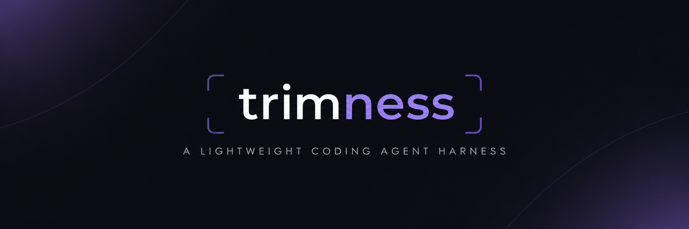

# trimness ⚡

**A lightweight coding agent harness built in Go.**

*Less context. Fewer tokens. Same results.*

 

---

### About

Trimness is an experimental coding agent harness exploring how to reduce token usage and execution costs without sacrificing correctness.

Built from scratch in **Go**, with two main goals:

- **Smarter inputs** — Filter noisy tool outputs and unnecessary context.
- **Leaner outputs** — Make targeted code edits instead of rewriting entire files.

### How it works

**User → Agent → LLM → Tools → Results → Agent**

The agent can read files, search code, make edits, and run tests. Future optimizations will focus on reducing the tokens exchanged throughout this process.

### Roadmap

- [ ] **01 / Harness** — Build the core coding agent.
- [ ] **02 / Observe** — Track tokens, cost, and execution traces.
- [ ] **03 / Input** — Optimize tool observations.
- [ ] **04 / Output** — Optimize code editing strategies.
- [ ] **05 / Evaluate** — Benchmark and publish findings.

### Philosophy

> Less isn't always better. Measure what matters.

Trimness prioritizes **cost per successful task**, not just fewer tokens.

---

**Built with Go. Designed for efficiency.**

